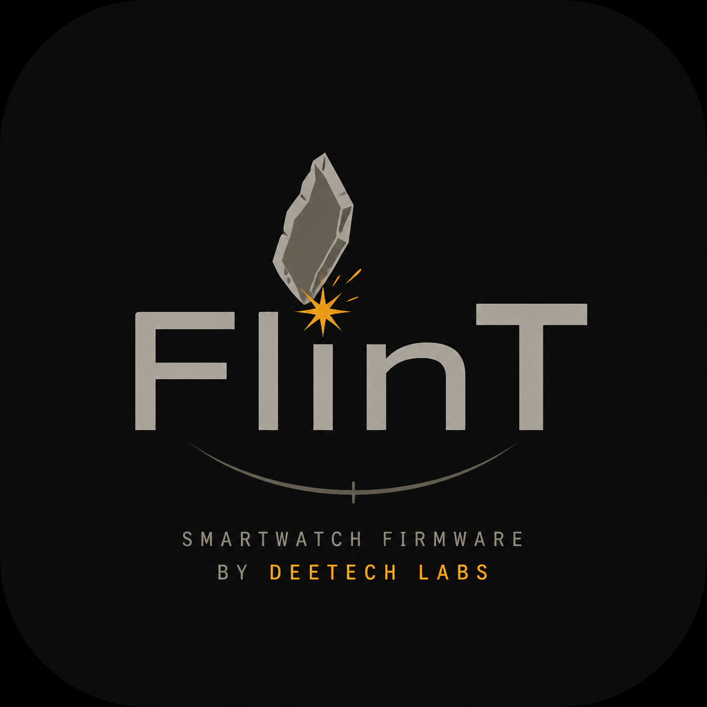

<p align="center">
  
</p>

<h1 align="center">FlinT OS</h1>

<p align="center">
  <strong>Open firmware platform</strong> for FlinT devices · pluggable faces · by
  <a href="https://github.com/deetech-labs">DeeTech Labs</a>
</p>

<p align="center">
  
  
  
  
  
  
  
</p>

---

## What it is

**FlinT OS** is the software stack for the FlinT ecosystem. Core services stay stable; **faces are plugins** — add a theme without rewriting networking, time, or weather.

| Built-in today | Coming next |
|----------------|-------------|
| Digital face + day modes + glances | More community faces |
| Soft-clock + SNTP + timezone DB | SoftAP provisioning |
| Open-Meteo current + daily/hourly | Hardware buttons (serial keys for now) |
| Wi‑Fi, NVS settings, face picker | OTA flow |
| Event bus | |
| Boot splash | |

Architecture: [`docs/ARCHITECTURE.md`](docs/ARCHITECTURE.md) · Face SDK: `components/flint/sdk/flint_face_sdk.h`

---

## Quick start (ESP-IDF)

1. **Board:** FlinT Spark (ESP32-C3, USB Serial/JTAG)
2. **ESP-IDF** v5.x / v6.x activated (`source …/activate_idf_….sh` or EIM)
3. **Secrets:**
   ```bash
   cp components/flint/config/secrets.example.h components/flint/config/secrets.h
   ```
   Edit Wi‑Fi credentials (`secrets.h` is gitignored).
4. **Build & flash:**
   ```bash
   idf.py set-target esp32c3
   idf.py build
   idf.py -p /dev/ttyACM0 flash monitor
   ```
   Optional board profile (default **FlinT Spark** / `flint_spark`):
   ```bash
   idf.py -DFLINT_BOARD=flint_spark build
   # or: python3 tools/gen_board_catalog.py --board flint_spark --build
   ```
   See [`components/flint/board/README.md`](components/flint/board/README.md) (full setup guide).

### Serial controls (no buttons yet)

In the IDF monitor, type keys (no Enter needed except where noted):

| Key | Action |
|-----|--------|
| `Enter` | Face picker (from face) / apply face / open Face row |
| `s` | Settings |
| `p` / `n` | Navigate (picker item or settings row) |
| `+` / `-` | Adjust selected setting only |
| `q` / `Esc` | Back to face |
| `h` | Help in log |

Active face and prefs are stored in NVS (face, seconds, hour format, language, timezone, weather lat/lon).

Settings: `p`/`n` navigate, `+/-` change value, `Enter` only opens face picker from the Face row. Shell transitions are instant (no fade wash).

Dependencies:
- [LovyanGFX](https://github.com/lovyan03/LovyanGFX) — slim local component (`components/LovyanGFX`); `src/` sparse-cloned to `third_party/LovyanGFX/` (no upstream examples)

Flash is kept lean: no LVGL, no C++ exceptions, STA-only WPA2 Wi‑Fi (no SoftAP/WPA3), trimmed LWIP/mbedTLS, HTTP weather (no HTTPS/CA bundle). See `config/sdkconfig.defaults`.

---

## Project layout

```
flint_os/
├── main/                 # entry only (app_main)
├── config/               # sdkconfig.defaults + partitions.csv
├── components/
│   ├── flint/            # ★ all product code
│   │   ├── board/        # ★ hardware profiles (JSON → board_config.inc)
│   │   ├── app/ shell/ settings/ sdk/
│   │   ├── faces/        # Face API + themes
│   │   └── display/ net/ time/ weather/ …
│   └── LovyanGFX/        # slim CMake (bus sources from board)
├── tools/                # codegen — see tools/README.md (or: ./flint_tools)
├── flint_tools           # bash picker for tools/*.py
├── third_party/LovyanGFX/# upstream sources (gitignored, cloned on build)
├── community/            # face templates
└── brand/
```

---

## Add a face

1. Copy `community/face_template.cpp.example` → `components/flint/faces/face_yourname.cpp`
2. `#include "sdk/flint_face_sdk.h"` only — implement `Face`, export `Face* createYourFace()`
3. Register in `components/flint/faces/faces_builtin.cpp`
4. Build & flash; pick via serial face picker (or default `ACTIVE_FACE_ID` on empty NVS)

---

## Hardware (reference)

Default device: **FlinT Spark** (`flint_spark` in `components/flint/board/`).

| Signal | ESP32-C3 |
|--------|----------|
| SCK | GPIO 6 |
| MOSI (SDA) | GPIO 7 |
| CS | GPIO 10 |
| DC | GPIO 9 |
| RST | GPIO 8 |
| VCC / LED | 3.3V |
| GND | GND |

Display: GMT028-class panel, **ST7789** 240×280 SPI (landscape UI 280×240).

To change pins or panel: edit JSON under `components/flint/board/`
(and rebuild with `-DFLINT_BOARD=…`). Common SPI panels need no C++ — see the board guide.

---

## License

Copyright 2026 DeeTech Labs

Licensed under the [Apache License, Version 2.0](LICENSE).

You may use, modify, and distribute this software. Redistributions must keep the
copyright notice, license text, and attribution from [`NOTICE`](NOTICE)
(original work by DeeTech Labs / FlinT OS).

---

## Contributing

- Prefer **new files under `components/flint/faces/`** over edits to services
- Include only `sdk/flint_face_sdk.h` from faces; keep `onTick` non-blocking
- Hardware variants: see guide in [`components/flint/board/README.md`](components/flint/board/README.md)
- Never commit `components/flint/config/secrets.h`

---

<p align="center">
  <sub>FlinT OS · DeeTech Labs · Apache 2.0 · ESP-IDF</sub>
</p>
