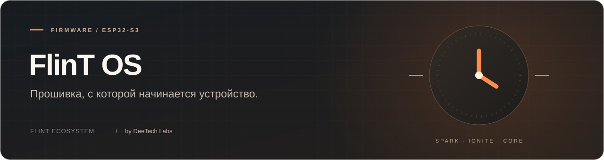

<p align="center">
  
</p>

<p align="center">
  <a href="LICENSE"></a>
  
  
</p>

<p align="center">
  <a href="#быстрый-старт">Быстрый старт</a> &nbsp; · &nbsp; <a href="#документация">Документация</a> &nbsp; · &nbsp; <a href="#лицензия">Лицензия</a> &nbsp; · &nbsp; <a href="#участники">Участники</a>
</p>

<p align="center">
  <a href="docs/en/README.md">English version</a> &nbsp; / &nbsp;
  <a href="https://flint.deetech.ru/">Сайт экосистемы</a> &nbsp; / &nbsp;
  <a href="https://github.com/DeeTech-Labs">DeeTech Labs</a>
</p>

---

Прошивка устройств **FlinT**, разработка **DeeTech Labs**. Базовое устройство — **FlinT Spark** на ESP32-S3 Super Mini.

## Возможности

- **Приложения без перепрошивки.** Циферблаты, темы, языки и ресурсы устанавливаются пакетами Ignite.
- **Одна платформа.** Переносимые Core и Runtime общие с Flare и локальным симулятором.
- **Контроль доступа.** Разрешения приложений, защищённые заводские компоненты и атомарное хранилище.
- **Связь и восстановление.** USB, аутентифицированный BLE и восстановление независимо от активного приложения.

## Быстрый старт

Команды выполняются из корня репозитория. Требуется ESP-IDF 6.1.0; нужны Python 3 и Pillow для обработки ресурсов.

Рабочее дерево `platform/` содержит согласованные touch/UI-изменения SDK и генерацию в каталог сборки; внешний override для локальной сборки не нужен. Эти правки пока не закоммичены, поэтому один прежний pin не воспроизводит рабочее дерево. [Состояние интеграции](docs/ru/development/sdk-integration.md).


```sh
git submodule update --init --recursive
python3 tools/select_device.py --list
python3 tools/select_device.py --build
```

В активированном окружении ESP-IDF можно использовать `idf.py -DSDKCONFIG=config/sdkconfig -DIDF_TARGET=esp32s3 build`. `set-target` нужен только при намеренной смене цели. Подробности: [сборка ESP-IDF](docs/ru/getting-started/building.md).

`platform/` — подмодуль [Flint IgniteSDK](https://github.com/DeeTech-Labs/Flint-IgniteSDK), закреплённый на коммите. Общие изменения вносятся в SDK; OS и Flare обновляют ссылку подмодуля. Экспорта копий исходников нет.

## Приложения и управление

Ignite Hub в Flint Flare устанавливает, запускает и удаляет пользовательские пакеты, выбирает часы, тему и язык, выдаёт и отзывает разрешения. Пользовательские пакеты не могут удалить заводские компоненты. Заводские пакеты размещены в read-only `factory`, пользовательские пакеты, настройки и согласия — в `storage`.

Lua — единственный язык приложений; ограниченный Runtime включён и физически проверен на Spark. Фоновые службы не поддерживаются. Проверки платы выполняются отдельно от локальных тестов. [Пакеты Ignite](docs/ru/development/ignite-packages.md), [контракт платформы](platform/README.md).

<details>
<summary><b>Аппаратная конфигурация Spark</b></summary>

Профиль `flint_spark_s3_supermini`, дисплей ST7789 240×280, альбомный интерфейс 280×240. Подключение: SCK — GPIO12, MOSI/SDA — GPIO11, CS — GPIO10, DC — GPIO4, RST — GPIO5, VCC/LED — 3,3 В, GND — GND. Встроенный светодиод отключён до проверки конфигурации.

На проверенной плате Flash 4 МиБ и Quad PSRAM 2 МиБ. Flash содержит два слота прошивки по 1 МиБ, 192 КиБ заводских пакетов и 1728 КиБ пользовательских данных; PSRAM — отдельная энергозависимая память. Перед переходом на новую карту разделов сохраните и перенесите данные, запишите таблицу и заводской образ; OTA только приложения недостаточно. [Конфигурация](docs/ru/development/configuration.md), [профиль платы](docs/ru/hardware/spark-s3-supermini.md).

Аппаратные исходники фиксированы по модели/ревизии в `src/board/models/`; выбор поддерживаемой ревизии — `-DFLINT_DEVICE=…`. Поддержки C3 нет.

</details>

## Структура и проверка

`main/` — вход ESP-IDF; `config/` — конфигурация и разделы; `src/` — аппаратные адаптеры, транспорт и восстановление, включая драйвер ST7789 поверх SPI Master ESP-IDF; `platform/` — общая платформа; `tools/` — инструменты устройства; `resources/` — логотипы и иллюстрации; `cmake/` — модули сборки; `tests/` — тесты.

```sh
cmake -S platform -B /tmp/flint-platform -DCMAKE_BUILD_TYPE=Debug
cmake --build /tmp/flint-platform
ctest --test-dir /tmp/flint-platform --output-on-failure
python3 -m unittest discover -s tests/tooling -v
```

Локальные тесты не подключаются к устройству и не прошивают его.

## Документация

[Оглавление документации](docs/ru/README.md) · [Структура репозитория и миграция](docs/ru/development/repository-layout.md).

- [Архитектура](docs/ru/architecture/overview.md).
- [Companion USB/BLE](docs/ru/architecture/companion-protocol.md).
- [План развития](docs/ru/project/roadmap.md).
- [Инструменты](docs/ru/development/tools.md).
- [История изменений](CHANGELOG.md).
- [Вклад в проект](CONTRIBUTING.md), [поддержка](SUPPORT.md), [безопасность](SECURITY.md), [правила сообщества](CODE_OF_CONDUCT.md).

Общий сайт Spark, OS и Flare: [flint.deetech.ru](https://flint.deetech.ru/), исходники — [FlinT-Web](https://github.com/DeeTech-Labs/FlinT-Web). Обсуждения: [Discussions](https://github.com/DeeTech-Labs/FlinT-OS/discussions).

---

## Лицензия

[PolyForm Noncommercial 1.0.0](LICENSE) + [FlinT Community Exception](docs/ru/legal/community-exception.md). Разрешены некоммерческие форки и любительские устройства с компенсацией подтверждённой себестоимости, без прибыли. Коммерческое использование за пределами разрешений требует отдельного соглашения.

[Все условия лицензирования](docs/ru/legal/licensing.md) · [Уведомления о компонентах](NOTICE).

## Участники

Спасибо всем, кто помогает развивать **FlinT OS**: пишет код, проверяет сборки, находит ошибки, улучшает документацию и переводы.

<a href="https://github.com/DeeTech-Labs/FlinT-OS/graphs/contributors">
  
</a>

<p><sub>FlinT OS · Часть экосистемы FlinT · Разработка DeeTech Labs</sub></p>
