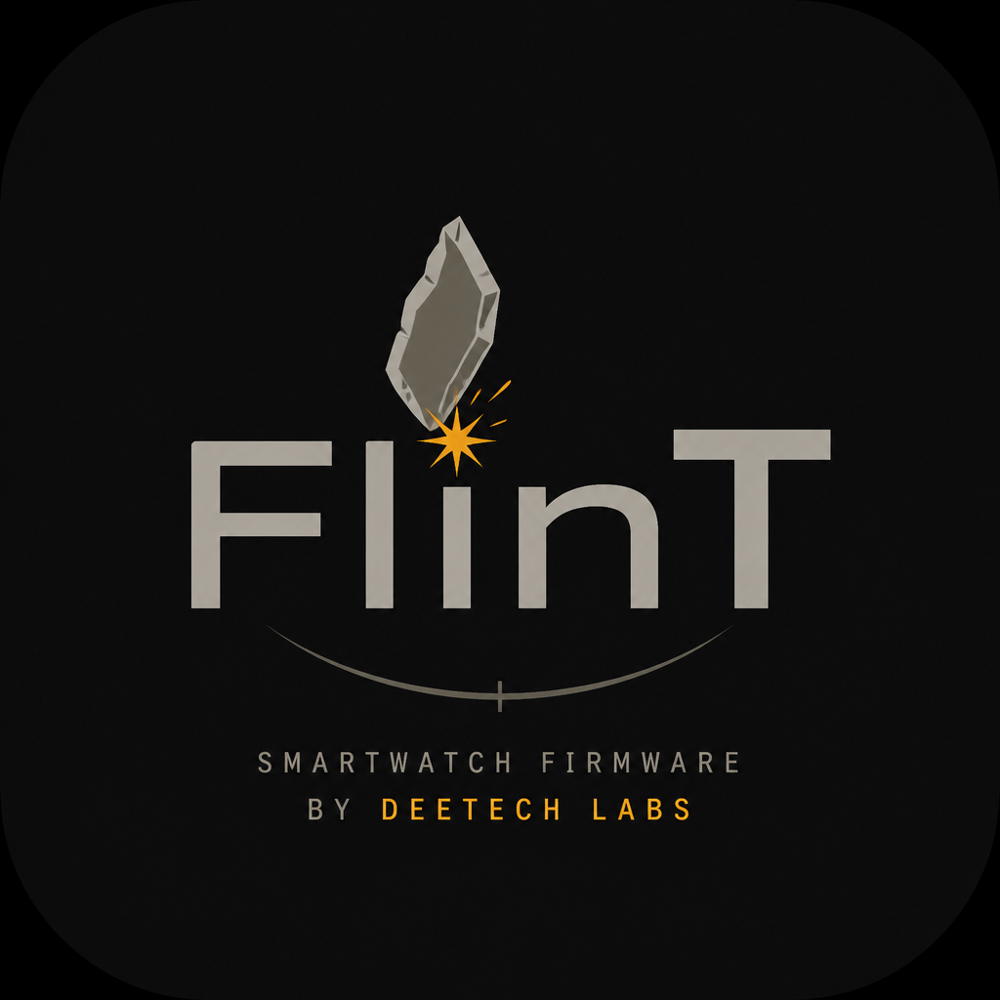

<p align="center">
  
</p>

<h1 align="center">FlinT OS</h1>

<p align="center">
  <b>Open firmware</b> for <b>FlinT</b> devices · Ignite packages · ESP32‑S3 / ESP‑IDF<br/>
  by <a href="https://github.com/DeeTech-Labs">DeeTech Labs</a>
</p>

<p align="center">
  <a href="https://github.com/DeeTech-Labs/FlinT-OS/stargazers"></a>
  
  
  <a href="LICENSE"></a>
</p>

<p align="center">
  <a href="#quick-start">Quick start</a> ·
  <a href="#docs">Docs</a> ·
  <a href="docs/IGNITS.md">Ignite</a> ·
  <a href="https://github.com/DeeTech-Labs/FlinT-OS/discussions">Discussions</a>
</p>

---

## Website

The shared website for Spark, FlinT OS and Flare is maintained in
[FlinT-Web](https://github.com/DeeTech-Labs/FlinT-Web) and published at
[flint.deetech.ru](https://flint.deetech.ru/).

## What it is

**FlinT OS** is the firmware platform for **FlinT** devices (base board: **FlinT Spark**), by **DeeTech Labs**.

Core services provide hardware, time, storage, security and recovery. **Apps are Ignite packages**: install screens, watch faces, themes, languages and resources without changing firmware source.

<table>
  <tr>
    <td width="50%" valign="top">
      <h3>Built-in</h3>
      <ul>
        <li>Protected factory components · installable Ignite packages</li>
        <li>Core time service · USB/BLE PC synchronization</li>
        <li>Offline · atomic package storage and persisted consent</li>
        <li>Shared Runtime · event bus · independent recovery</li>
      </ul>
    </td>
    <td width="50%" valign="top">
      <h3>Stack</h3>
      <ul>
        <li>ESP‑IDF · LovyanGFX (slim)</li>
        <li><code>-Os</code> · no C++ exceptions / RTTI</li>
        <li>Dual application slots · protected factory volume · user storage</li>
        <li>Binary Companion over native USB and authenticated BLE</li>
      </ul>
    </td>
  </tr>
</table>

---

## Quick start

**Board:** FlinT Spark (ESP32‑S3, USB Serial/JTAG) · **ESP‑IDF** 6.0.2

```bash
idf.py set-target esp32s3
idf.py build
idf.py -p /dev/ttyACM0 flash
```

Time synchronization and package management are available through **Flint Flare**.
USB and BLE use the same binary Companion v1 contract; there is no serial-command fallback.

Optional: `idf.py -DFLINT_DEVICE=flint_spark_s3_supermini build` · board guide: [`components/flint/board/README.md`](components/flint/board/README.md)

<details>
<summary><b>Application controls</b></summary>

Use Flare's Ignite Hub to install, open and remove user packages, select clock/theme/language providers, and grant or revoke application access. Factory components cannot be removed by user packages. Recovery remains available independently of the active application.

Factory packages are provisioned on the read-only `factory` volume. User packages, settings and consent records live in writable `storage`. New applications do not require a firmware source change or reflash.

</details>

<details>
<summary><b>Hardware — FlinT Spark pinout</b></summary>

Default device revision: `flint_spark_s3_supermini`. Display: GMT028-class **ST7789** 240×280 SPI (UI landscape 280×240).

| Signal | GPIO |
|--------|:----:|
| SCK | 12 |
| MOSI (SDA) | 11 |
| CS | 10 |
| DC | 4 |
| RST | 5 |
| VCC / LED | 3.3V |
| GND | GND |

Spark uses an ESP32-S3 Super Mini. The connected development unit has verified 4 MiB Flash and 2 MiB Quad PSRAM. The Flash map provides two 1 MiB firmware slots, 192 KiB factory storage and 1728 KiB user storage; PSRAM is separate volatile memory. See [`config/README.md`](config/README.md) for partition migration requirements. The onboard LED remains disabled until its configuration is verified.

Hardware is fixed per model/revision under `components/flint/board/models/`. Select a supported revision with `-DFLINT_DEVICE=…`.

</details>

<details>
<summary><b>Project layout</b></summary>

```
flint_os/
├── main/                 # ESP-IDF entry point
├── config/               # sdkconfig.defaults + partitions.csv
├── components/
│   ├── flint/            # hardware, links and recovery integration
│   └── LovyanGFX/        # slim hardware display component
├── platform/             # shared Core, Runtime, SDK, compiler and tests
│   ├── system/           # source factory Ignite projects
│   └── factory/          # compiled factory packages
├── tools/                # device selection and shared-source export
└── brand/                # marketing logo
```

</details>

---

## Docs

USB and BLE share the binary Companion contract. See the
[companion protocol](docs/COMPANION-PROTOCOL.md) for framing, compatibility and trust.

| Doc | Contents |
|-----|----------|
| [`platform/README.md`](platform/README.md) | Shared platform contracts, security, formats and current limits |
| [`docs/IGNITS.md`](docs/IGNITS.md) | Binary packages and project compilation |
| [`docs/ROADMAP.md`](docs/ROADMAP.md) | Migration milestones and hardware validation |
| [`docs/ARCHITECTURE.md`](docs/ARCHITECTURE.md) | Core, Runtime, hardware and application boundaries |
| [`docs/ESP-IDF.md`](docs/ESP-IDF.md) | Build and target configuration |
| [`components/flint/board/README.md`](components/flint/board/README.md) | Board profile and wiring |
| [`tools/README.md`](tools/README.md) | Local development tools |
| [`CHANGELOG.md`](CHANGELOG.md) | Release history (Keep a Changelog) |

Public API, Face SDK, package format and protocol versions remain **1** during active development. Wasm and executable background services are not advertised pending runtime validation. Physical-device checks are separate from the local test suite.

---

## Contributing

[CONTRIBUTING.md](CONTRIBUTING.md) · [SUPPORT.md](SUPPORT.md) · [SECURITY.md](SECURITY.md) · [CODE_OF_CONDUCT.md](CODE_OF_CONDUCT.md) · [Discussions](https://github.com/DeeTech-Labs/FlinT-OS/discussions)

---

## License

Copyright 2026 DeeTech Labs · [Apache License 2.0](LICENSE) · keep attribution in [`NOTICE`](NOTICE)

---

## Contributors

Thanks to everyone who has contributed to FlinT OS:

<p align="center">
  <a href="https://github.com/DeeTech-Labs/FlinT-OS/graphs/contributors">
    
  </a>
</p>

<p align="center">
  <sub>FlinT OS · DeeTech Labs · Apache 2.0 · ESP‑IDF</sub>
</p>
